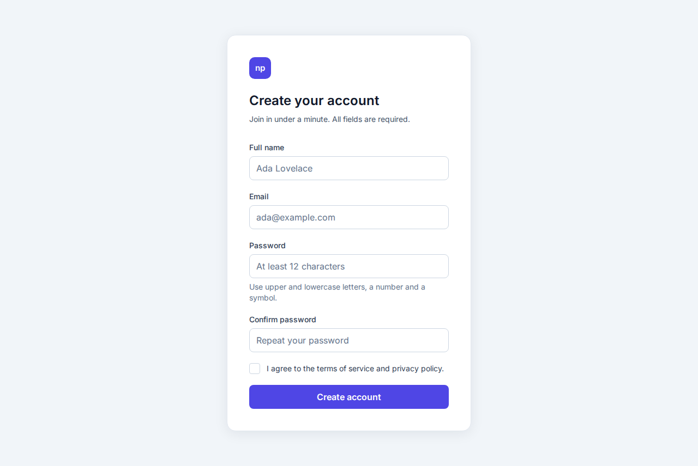
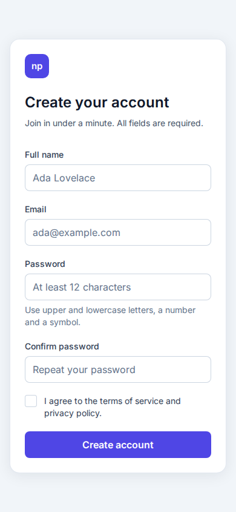
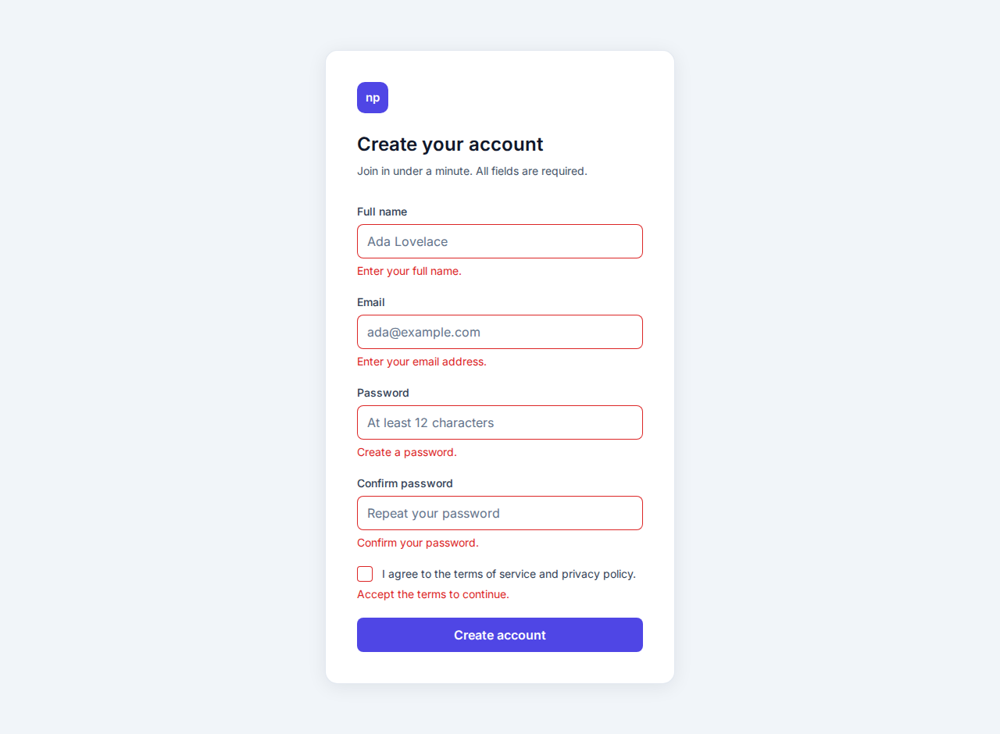
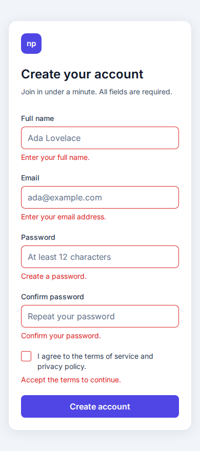
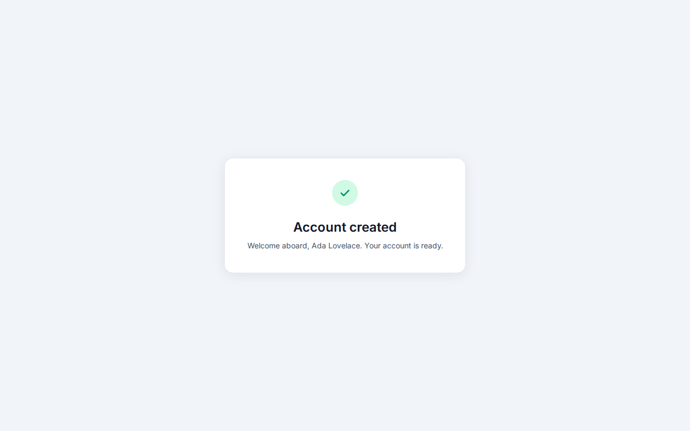
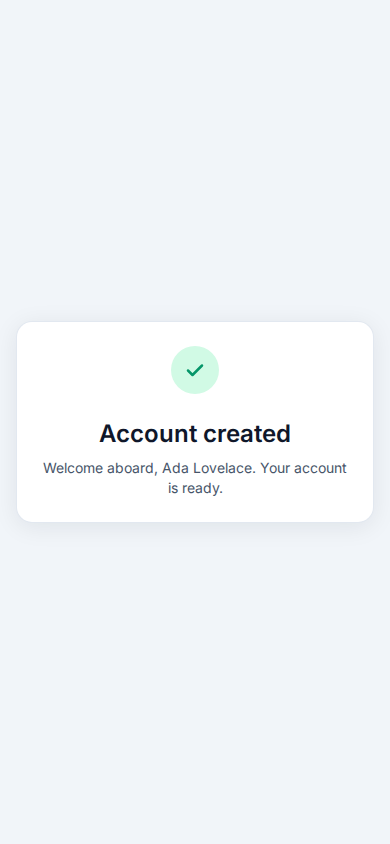

# Nodes vs Pixels

One sign-up form, built twice:

- **web-react**: React, TypeScript and Tailwind CSS render DOM nodes.
- **web-wasm**: Rust compiled to WebAssembly paints every pixel on a
  single `<canvas>`, the page's only element.

Both frontends talk to the same Rust **backend** over gRPC-web.

## Layout

| Path | Purpose |
| --- | --- |
| `proto/` | gRPC API contract |
| `design/` | Design tokens and font shared by both frontends |
| `spec/` | UI copy and validation conformance cases shared by every project |
| `seo/` | Single source of SEO metadata, injected into both frontends |
| `crates/form-core/` | Rust field rules shared by the backend and web-wasm |
| `backend/` | Rust gRPC and gRPC-web server (tonic) |
| `web-react/` | React, TypeScript and Tailwind CSS frontend |
| `web-wasm/` | Rust canvas frontend compiled to WebAssembly |
| `e2e/` | Playwright tests of both frontends, including visual parity |
| `deploy/` | Kind cluster and Helm chart |

## Screenshots

Both frontends running on Kind, captured by `make screenshots`. The parity
test fails if more than 0.5% of the pixels differ between the two.

| State | React (nodes) | WebAssembly (pixels) |
| --- | --- | --- |
| Empty, desktop |  |  |
| Empty, phone |  |  |
| Errors, desktop |  |  |
| Errors, phone |  |  |
| Success, desktop |  |  |
| Success, phone |  |  |

## The canvas frontend

The WebAssembly page has no inputs, labels or button: it is one focusable
`<canvas>`, labelled as the page's main region. Rust lays the form out with
the same design tokens and font as the React app, paints it, and handles
everything Chrome's native controls do for the React app:

- focus: Tab and Shift+Tab through the controls and out of the page, also
  coming in from the browser's own controls, with the focus ring shown after
  keyboard use and the focused control scrolled into view;
- typing: caret movement and deletion by character, word and line with
  Chrome's shortcuts on Linux and macOS, selection with Shift, undo and
  redo across the page's inputs, the caret placed in mixed left-to-right
  and right-to-left text, and grapheme clusters and emoji sequences kept
  whole;
- the mouse: clicks, double and triple clicks, dragging a selection (with
  autoscroll past an input's sides), labels that focus their input, the
  wheel scrolling an input sideways, and the cursor and hover each element
  shows;
- the clipboard: copy, cut and paste, never copying a password;
- scrolling: the page follows the caret while typing, and keeps what is in
  view in place as messages above it come and go, as Chrome's scroll
  anchoring does.

Drawing every pixel has a price. Compared with the React app, the canvas
page has:

- no input method, so no composed input for Chinese, Japanese or Korean,
  and no on-screen keyboard on phones;
- no autofill or password manager, and no spell checking;
- no form for screen readers, which see only the labelled canvas;
- no context menu, and no selecting the page's text;
- Linux and macOS editing shortcuts only, without Windows' word movement
  or macOS's Emacs-style Control keys;
- carets a few pixels off Chrome's in some scripts, such as Burmese,
  Sinhala, Kannada and Khmer, whose shaping the canvas measures differently.

## How it is built

[Claude Code](https://claude.com/claude-code) (Claude Opus 5.5) writes the
code, and [Codex](https://developers.openai.com/codex) (GPT-6.1 Sol, medium
reasoning effort) reviews every commit before it reaches `main`:

1. Claude Code makes each change on a short-lived branch as a
   [Conventional Commit](https://www.conventionalcommits.org) of at most
   1,000 changed lines, lockfiles aside, with every project's lints and
   tests passing.
2. Codex reviews each commit locally:

   ```sh
   codex review --commit <sha> -c model='"gpt-6.1-sol"' -c model_reasoning_effort='"medium"'
   ```

3. Claude Code fixes each finding in the commit it concerns, or, when
   Chrome's behavior shows the finding is wrong, keeps the code and notes
   why. Codex then reviews the changed commits again, until none has a
   finding left.
4. `main` fast-forwards to the branch, so it has no merge commits and
   every commit on it was reviewed.

The repository has no pull requests or CI: the reviews run on the
developer's machine. To have Codex review pull requests on GitHub instead,
there are two ways:

- **The Codex GitHub app.** Connect the repository to Codex, enable code
  review for it in the Codex settings, and turn on *Automatic review* under
  *Personal preferences*; Codex then reviews pull requests as the *Review
  trigger* setting says. A comment that mentions `@codex review` asks for a
  review at any time, and a `## Code Review Rules` section in `AGENTS.md`
  tells Codex what to look for.
- **A GitHub Action.** A workflow such as
  `.github/workflows/codex-review.yml` runs
  [`openai/codex-action`](https://github.com/openai/codex-action) on each
  pull request, with an `OPENAI_API_KEY` repository secret, and posts its
  review as a comment. GitHub gives no secrets and only a read-only token to
  pull requests from forks, so it reviews only those from the repository's
  own branches:

  ```yaml
  on:
    pull_request:
      types: [opened, synchronize]
  jobs:
    review:
      if: github.event.pull_request.head.repo.full_name == github.repository
      runs-on: ubuntu-latest
      permissions:
        contents: read
      outputs:
        review: ${{ steps.codex.outputs.final-message }}
      steps:
        - uses: actions/checkout@v5
          with:
            ref: refs/pull/${{ github.event.pull_request.number }}/merge
            fetch-depth: 0
            persist-credentials: false
        - id: codex
          uses: openai/codex-action@v1
          with:
            openai-api-key: ${{ secrets.OPENAI_API_KEY }}
            model: gpt-6.1-sol
            effort: medium
            permission-profile: ":workspace"
            prompt: Review the changes of pull request #${{ github.event.pull_request.number }} against its base branch and report bugs.
    comment:
      needs: review
      if: needs.review.outputs.review != ''
      runs-on: ubuntu-latest
      permissions:
        issues: write
        pull-requests: write
      steps:
        - uses: actions/github-script@v7
          env:
            REVIEW: ${{ needs.review.outputs.review }}
          with:
            script: |
              await github.rest.issues.createComment({
                ...context.repo,
                issue_number: context.payload.pull_request.number,
                body: process.env.REVIEW,
              });
  ```

## Running

Needs Rust with the `wasm32-unknown-unknown` target, wasm-pack, Node.js with
pnpm, Docker, Kind, kubectl and Helm.

| Command | What it does |
| --- | --- |
| `make build` | Builds the backend and both frontends |
| `make test` | Lints, type-checks and tests every project |
| `make deploy` | Builds the images and installs the chart on a `nodes-vs-pixels` Kind cluster |
| `make e2e` | Runs the Playwright tests against the cluster |
| `make screenshots` | Updates the screenshots above |
| `make lighthouse` | Audits both frontends, mobile and desktop |
| `make sonar` | Measures coverage and analyzes each project on SonarQube Cloud (needs `SONAR_TOKEN`) |
| `make kind-down` | Deletes the cluster |

Once deployed, the React frontend is at http://localhost:8081 and the
WebAssembly one at http://localhost:8082.
